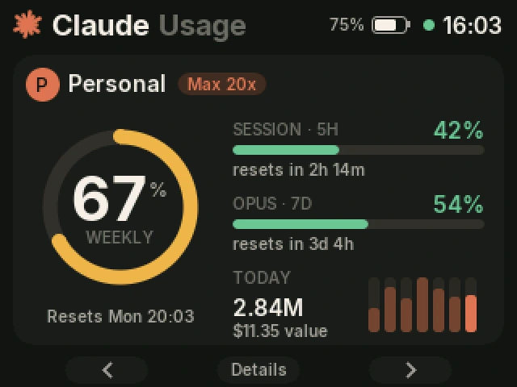

# m5claude — a Claude usage dashboard for the M5Stack Basic

Shows how much of your Claude plan is left, on your desk: the 5-hour session and weekly
limits of Pro and Max accounts (including per-model weekly limits), spend for API
organizations, and tokens per day, on an M5Stack Basic v2.7.



Two parts:

- **Firmware** (`firmware/` + `src/`) for the M5Stack Basic: draws the dashboard and
  receives data over **USB** or **Bluetooth LE**. It stores no credentials and no Wi-Fi settings.
- **Bridge** (`bridge/`), a small Python program for your PC: reads your Claude usage and
  sends the device a snapshot every minute. It finds the device by itself.

The full story, with diagrams: [A Claude usage dashboard on the M5Stack Basic](https://velxio.dev/blog/posts/claude-usage-dashboard-m5stack/).

## Quick start

You need an [M5Stack Basic v2.7](https://shop.m5stack.com/products/esp32-basic-core-lot-development-kit-v2-7)
(older Basic/Gray/Fire units with the same pins should work), a USB-C cable, Python 3.10+
and [`arduino-cli`](https://arduino.github.io/arduino-cli/).

**1. Flash the firmware**

```bash
arduino-cli core install esp32:esp32
arduino-cli lib install LovyanGFX NimBLE-Arduino ArduinoJson

./firmware/build.sh /dev/ttyUSB0       # Linux / macOS (port: arduino-cli board list)
.\firmware\build.ps1 -Upload           # Windows; finds the M5Stack's COM port itself
```

**2. Run the bridge**

```bash
pip install -e bridge                   # installs pyserial and bleak
m5claude-bridge                         # or: python -m m5claude_bridge
```

**3. Connect.** Plug in the cable, or just leave the device nearby: the bridge finds it over
Bluetooth, and the first time the device asks you to approve the computer (**C = Allow**).

Pro and Max accounts are picked up from Claude Code's logins automatically. API
organizations need an Admin API key; see [bridge/README.md](bridge/README.md).

## Using it

| Button | Action |
|---|---|
| **A / C** | previous / next account |
| **B** | next view: Overview → Limits → Tokens → Breakdown |
| **hold B** | ask the bridge for fresh data now |
| **hold A while powering on** | forget every approved computer |

The dot next to the clock is green while data is fresh, amber when it is stale and red when
no computer is connected.

## How it works

```
 Claude Code login ──┐
 Claude Code logs  ──┼──▶ bridge (Python) ── USB serial / Bluetooth LE ──▶ M5Stack
 Admin API (orgs) ───┘    one JSON line per minute                       draws it
```

The bridge does all the work; the device only draws what it receives. Messages are
newline-delimited JSON in both directions, identical over USB and BLE:

| Direction | Message | Meaning |
|---|---|---|
| bridge → device | `{"pc":"<name>","pcid":"<id>"}` | who is connecting (first line on a link) |
| bridge → device | `{"v":1,"ts":…,"tz":…,"acc":[…]}` | snapshot, see `bridge/m5claude_bridge/snapshot.py` |
| device → bridge | `{"hello":"m5claude","id":"M5C-8BC6","fw":"0.1.0"}` | greeting, repeated until data flows |
| device → bridge | `{"req":"refresh"}` | the user held B |
| device → bridge | `{"pair":"pending"\|"ok"\|"denied"}` | Bluetooth approval state |

USB is trusted (plugging the cable in is the approval). On Bluetooth each computer is
approved once on the device; up to four are remembered.

## Code tour

### Firmware

| File | What it does |
|---|---|
| `firmware/m5claude/m5claude.ino` | The board: explicit ILI9342C panel config (VSPI, pins, IPS color inversion), USB serial link, BLE GATT service (one write characteristic in, one notify characteristic out) with NimBLE, approved-PC list in NVS, `setup()` / `loop()`. |
| `src/app/app.h`, `app.cpp` | The protocol, independent of the transport: a line buffer per link, greeting until data flows, the pairing state machine (asks the UI, remembers the answer), refresh requests, and the clock (the Basic has no RTC, so time comes from the snapshot). |
| `src/model/model.h` | The data model: accounts, limits (`Limit`), tokens, per-model shares. |
| `src/model/parse.cpp` | Snapshot JSON → model, with ArduinoJson. A bad line leaves the current data untouched. |
| `src/model/mock.cpp` | Demo accounts, handy while designing the screens. |
| `src/ui/ui.h`, `ui.cpp` | The four views, the adaptive overview (1, 2 or 3+ accounts), button handling (click / long press), animations, toasts, the approval prompt, and rendering in bands. |
| `src/ui/gfx.h` | Drawing helpers on top of LovyanGFX: colors, rounded bars, the anti-aliased ring gauge, and the band offset. |
| `src/ui/fonts_gen.h` | Inter at six sizes as anti-aliased VLW fonts (generated). |
| `firmware/build.ps1`, `build.sh` | Compile and flash with `arduino-cli` (C++17, large-app partition). |

**Rendering without PSRAM.** A 320×240 frame is 150 KB, more than the largest free block.
The UI is drawn four times into a 320×60 band (38 KB). Two band buffers alternate: one is
drawn while the other is still going out over SPI DMA, and the code waits for a transfer to
finish before reusing its buffer (reusing it early mixes bands on the panel).

### Bridge

| File | What it does |
|---|---|
| `bridge/m5claude_bridge/__main__.py` | Command line: `run` (default), `snapshot`, `accounts`, `init`, `add-api`. The refresh loop. |
| `config.py` | Accounts: auto-detects every Claude Code config dir with a login (`~/.claude`, `~/.claude-*`), or reads `~/.m5claude/config.json`. |
| `sources/subscription.py` | Pro/Max limits: reads the account's Claude Code login and the limits Claude Code's `/usage` shows (session, weekly, per model). Never refreshes the login. |
| `sources/local_logs.py` | Tokens from Claude Code's transcripts (`projects/**/*.jsonl`): incremental parsing, de-duplication across resumed sessions, totals per day and model. |
| `sources/admin_api.py` | API organizations: `usage_report/messages` and `cost_report` from the Usage and Cost Admin API. |
| `pricing.py` | API list prices, to estimate the value of subscription usage. |
| `snapshot.py` | Builds the snapshot; polls limits every 5 minutes, caches the last good answer on disk, backs off when rate limited. |
| `hub.py` | Sends the newest snapshot to every connected device; handles messages from devices. |
| `transports/usb_serial.py` | Finds M5Stack USB-UART chips (CH9102, CP2104), keeps a port only if the firmware greets it. |
| `transports/ble.py` | Scans for the service UUID, connects, waits for approval, streams in MTU-sized chunks. |
| `transports/tcp.py` | A local TCP link (127.0.0.1:47800) for development. |
| `webapi.py` | JSON over HTTPS with `urllib` (no extra dependency). |

### Tools

| File | What it does |
|---|---|
| `tools/make_fonts.py` | Regenerates `src/ui/fonts_gen.h` from the [Inter](https://github.com/rsms/inter) TTFs placed in `tools/fonts/` (Pillow). |

## Troubleshooting

- **"Limits: Rate limited, retrying"** — the limits endpoint throttles frequent requests.
  The bridge retries every 5 minutes and keeps showing the last good values.
- **"Login expired"** — use Claude Code with that account once; the bridge recovers on the
  next refresh.
- **Flashing fails with "port busy"** — the bridge is holding the USB port; stop it while
  flashing, or run it with `--no-usb`.

## Caveats

The plan-limits endpoint is the one Claude Code uses for `/usage`; it is not a documented
public API and may change. Dollar figures for subscriptions are estimates at API list prices.

## License

MIT, see [LICENSE](LICENSE). The Inter font embedded in `src/ui/fonts_gen.h` is under the
SIL Open Font License 1.1.
